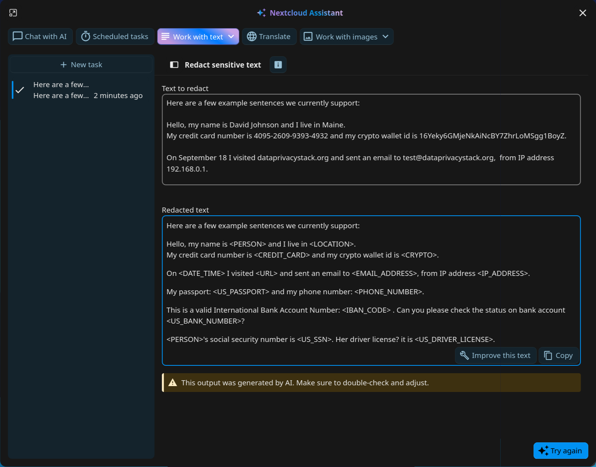
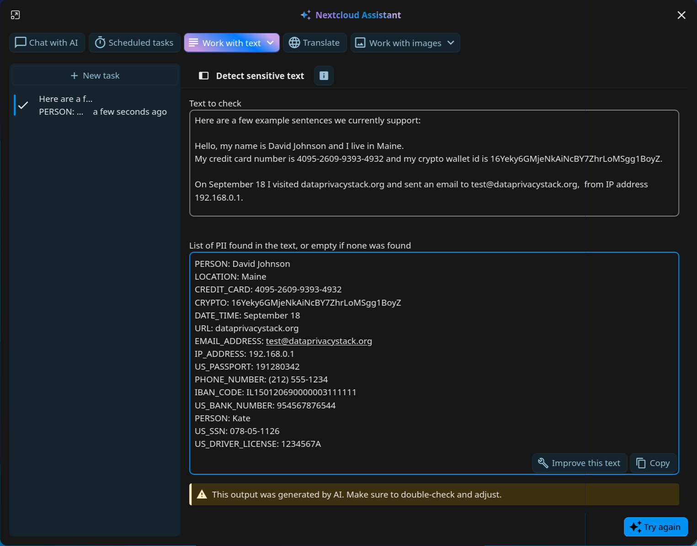
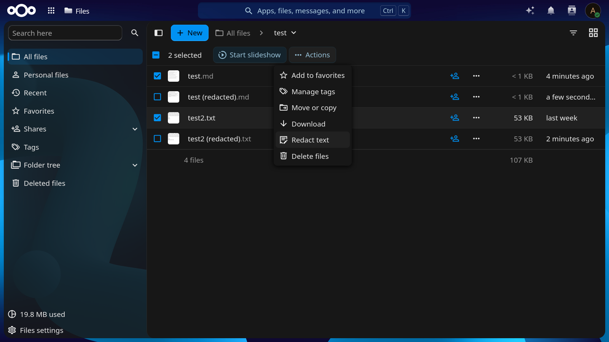

<!--
SPDX-FileCopyrightText: 2026 Nextcloud GmbH and Nextcloud contributors
SPDX-License-Identifier: AGPL-3.0-or-later
-->

# Nextcloud Text Anonymizer

A Nextcloud ExApp that detects and redacts personal and sensitive information (PII) in text and text files.
It is useful when the text is going to be used somewhere it might leak, for example in an AI prompt.

It uses [Presidio](https://presidio.dataprivacystack.org/) under the hood, with the
[`en_core_web_lg`](https://spacy.io/models/en#en_core_web_lg) spaCy model for named entity recognition.

## Features

- **Two TaskProcessing task types.** Other apps and users can call these through the Nextcloud TaskProcessing API,
  for example from the Assistant:
  - **Detect sensitive text** (`core:text2text:detect_pii`) lists each distinct PII entity found in the input as a
    `TYPE: value` line, in order of first appearance. The output is empty if nothing was found.
  - **Redact sensitive text** (`core:text2text:redact_pii`) replaces each PII entity with a placeholder naming its
    type, e.g. `Call John at 555-123-4567` becomes `Call <PERSON> at <PHONE_NUMBER>`.
- **"Redact text" action in Files.** Text files have a "Redact text" entry in their action menu. It saves a redacted
  copy next to the original, e.g. `notes (redacted).txt` (then `notes (redacted 2).txt`, and so on), and leaves the
  original file unchanged. A notification tells the user when the copy is ready or why it failed. Files are read and
  written as the user who started the action, so Nextcloud's usual file permissions apply.
- **Detects Presidio's built-in entity types**, such as names, email addresses, phone numbers, locations, dates,
  credit card numbers, IBANs, IP addresses, URLs and several country-specific ID numbers. See Presidio's
  [list of supported entities](https://presidio.dataprivacystack.org/supported_entities/).
- **Handles long texts.** Text is analyzed in chunks of up to 10,000 characters, split at line breaks or spaces where
  possible, and the task progress is reported to Nextcloud after each chunk.
- **Picks up tasks quickly.** On Nextcloud 33 and later, Nextcloud notifies the app as soon as a new task is
  scheduled. On older versions, the app checks for new tasks every 5 seconds.

## Screenshots







## Limitations

- **English only.** Texts in other languages are analyzed with the English model and recognizers, so many entities
  will be missed.
- **Detection is not perfect.** Presidio combines pattern matching with a statistical model, so it can miss entities
  and flag text that is not sensitive. Check the output before relying on it, especially for sensitive data.
- **Redaction cannot be undone.** Every entity of the same type gets the same placeholder, so the output does not show
  whether two `<PERSON>` placeholders refer to the same person, and the original values cannot be recovered from it.
- **Detection output contains the sensitive values.** The "Detect sensitive text" task returns the values it found,
  so its output needs the same care as the input.
- **Only plain text files.** The Files action is offered only for `text/*` files and only works with UTF-8 encoded
  content. Documents such as ODT, DOCX or PDF are not supported.
- **One task at a time.** Tasks are processed one after another, on the CPU only. The first task after the app starts
  takes several seconds longer while the spaCy model loads.
- **Entities split across chunks may be missed.** In texts longer than 10,000 characters, an entity that happens to
  span a chunk boundary may not be detected. Chunks are split at line breaks or spaces to make this rare.
- **No settings.** There is no admin or user configuration yet, e.g. for choosing languages or entity types.

## Requirements

- Nextcloud server version 31 or later with [AppAPI](https://github.com/nextcloud/app_api) and a configured deploy daemon.

## Development

For building and running the ExApp for development:

```bash
# Activate the virtual environment
$(poetry env activate)

# Install dependencies
poetry install

# Start the app server
APP_HOST=0.0.0.0 APP_ID=text_anonymizer APP_PORT=9040 APP_SECRET=12345 APP_VERSION=<APP_VERSION> NEXTCLOUD_URL=http://nextcloud.local COMPUTE_DEVICE=CPU python3 ex_app/lib/main.py

# Register and enable the app in a local nextcloud-docker-dev environment
make register
```

Running `make` without a target lists the targets for other Nextcloud versions.

## License

[AGPL-3.0-or-later](./LICENSES/AGPL-3.0-or-later.txt)
